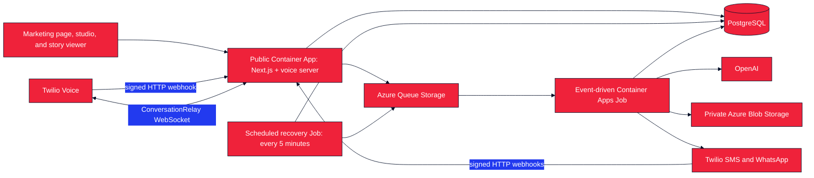

# Twilio Comics

Create AI-generated comic pages by texting an idea to a Twilio number, messaging an enabled WhatsApp sender, or calling to speak with a Twilio ConversationRelay voice agent. The agent helps shape the idea, asks for approval, and sends the finished comic after an Azure worker generates it. The public website shows how to start and displays finished stories; its browser comic studio is retained for testing.

Twilio Comics is a fork of [Make Comics](https://github.com/Nutlope/make-comics). Thanks to its original creators and contributors for the foundation.

## Architecture



The public Azure Container App hosts Next.js, signed Twilio webhooks, and the `/relay` ConversationRelay WebSocket. The event-driven Job handles inbound text turns and slow image generation from Azure Queue. A second, scheduled Job republishes work left pending after a temporary failure. All three workloads run the same image; the Jobs scale independently of the public app.

## Usage

### How people start

The public homepage (`/`) is an invitation to make a comic through Twilio. Set `TWILIO_ENABLED_CHANNELS` on the public Container App to choose which channels people see and can use. Use an ordered, comma-separated list such as `sms,whatsapp,voice`. The first listed channel with a valid configured destination gets the main start action and QR code; an SMS QR opens a text, a WhatsApp QR opens a chat, and a Voice QR opens the dialer. The page gives channel-specific steps for each available option. The selected channel affects the way a person starts, while the same agent handles the comic conversation and sends a story link when it is ready.

When `TWILIO_ENABLED_CHANNELS` is **unset**, the page keeps the default inferred behavior: a valid `TWILIO_PHONE_NUMBER` offers SMS and Voice, and a valid `whatsapp:`-prefixed `TWILIO_WHATSAPP_NUMBER` offers WhatsApp. When the variable is **set**, only listed channels with valid configured destinations are advertised and accepted by inbound webhooks. Set it to an empty value to disable all public start channels. With no available channel, the page says “opening soon” and offers no live action. This configuration reads local settings; it does not discover sender capabilities or approvals from Twilio Console. Verify each selected sender and webhook in Twilio before promoting the page. The example `+15551234567` is never a live destination.

| Example selection | Public starting point | Required destination |
|---|---|---|
| `sms` | Text an idea; SMS instructions and QR | `TWILIO_PHONE_NUMBER` with SMS capability |
| `whatsapp` | Open WhatsApp and message the approved sender | `TWILIO_WHATSAPP_NUMBER` |
| `voice` | Call and speak to the ConversationRelay agent | `TWILIO_PHONE_NUMBER` with Voice **and outbound SMS** capability, because the result is sent by SMS |
| `voice,whatsapp` | Call is primary; WhatsApp is also offered | Both destinations |
| Explicit empty value | “Opening soon,” without start actions | None |

| Channel | Where the idea arrives | Where the result goes |
|---|---|---|
| SMS/MMS | Text the Twilio number; `/api/twilio/sms` receives the webhook | Story link, with an MMS preview when available |
| WhatsApp, when enabled | Message the approved sender; `/api/twilio/whatsapp` receives the webhook | Story link, with an image preview when available |
| Voice | Call the Twilio number; `/api/twilio/voice` and `/relay` run ConversationRelay | Story link by SMS after the call, with an MMS preview when available |

### Public website

The homepage uses the Twilio bug in the header and favicon, a red, white, blue, and navy palette, and a matching social preview image. Its actions, QR code, and three-step instructions follow the enabled channels; with no configured destination, it shows “opening soon” without a QR code or contact action. The footer credits the [Make Comics](https://github.com/Nutlope/make-comics) project. The page styles are in `app/marketing.module.css`, and the social preview is in `app/opengraph-image.tsx`.

The browser composer lives at `/studio` for manual testing and development. It is not linked as a public start action. Finished comics remain viewable at `/story/{slug}`, including from links sent by text. Creating a comic in the studio or editing a browser-owned story requires Google sign-in; phone users do not need a browser account to start or receive a comic.

### Conversation flow

Start with a comic idea; a name is optional. The agent can ask a short follow-up question and accepts revisions. SMS and WhatsApp also accept up to two character photos, including photo-only messages. The agent summarizes a draft and waits for **`CREATE`** by text or **“create it”** by voice. Each approval requests one five-panel page; the app does not count panels in the generated image. The first approval starts a story; **`CONTINUE`** starts a draft for its next page in the same conversation channel. **`STATUS`** checks progress, **`DISCARD`** discards an unsubmitted text draft (say “cancel” on a call), and **`NEW`** starts a new story. While a page is generating, the draft stays locked until its job finishes. The same agent logic powers all channels, with a separate saved draft per number and channel. SMS opt-out, opt-in, and help keywords are handled by Twilio rather than by the comic agent.

The result message always includes a link to the full story. It also includes a compact image preview when available. A story made by phone can be viewed through that link. A Google sign-in is a separate identity, so signing in does not automatically grant edit rights to a phone-created story.

## How Pages Are Made

OpenAI `gpt-image-2` is prompted to generate a five-panel page from the approved idea and selected style. When the user supplies character photos or continues a story, the app passes those references, including the prior page when available, to the image edit API for visual continuity. A text model supplies the story title and description. The full image is saved in private Azure Blob Storage; the outbound message uses a smaller preview when available.

## Stack

- Next.js 16 and React 19
- Auth.js with Google OAuth
- PostgreSQL through Neon and Drizzle ORM
- OpenAI `gpt-image-2` for pages and a configurable text model for the agent and story metadata
- Azure Blob Storage for uploaded and generated images
- Azure Queue Storage, an event-driven Container Apps Job, and a scheduled recovery Job
- Twilio Programmable Messaging, WhatsApp, and ConversationRelay
- jsPDF for PDF export from the story page
- GitHub Actions, Azure OIDC, Azure Container Registry, and Azure Container Apps

## Installation

1. Install Node.js 22 and pnpm 10.20.0, then run `pnpm install`.
2. Copy `.example.env` to `.env` and fill in OpenAI, PostgreSQL, Auth.js, Azure Storage, and Twilio values needed for the channels you will test. Optionally set `TWILIO_ENABLED_CHANNELS` to the ordered list you intend to offer. Leave both sender numbers blank, or set the channel list to an empty value, to preview the public “opening soon” state; real sender values and Twilio credentials are needed for phone tests. Use a development database or Neon branch.
3. For a new empty database, run `pnpm db:migrate`. For an existing database, read the [migration gate](docs/DEPLOYMENT.md#database-migration-gate) before running file-based migrations.
4. Start the browser-only Next.js server with `pnpm dev` to inspect the marketing page and `/studio`, or run `pnpm dev:voice` for Next.js **and** `/relay` on port `8080`. The latter is the local equivalent of the production `pnpm start` entrypoint.

To preview the closed state, leave the sender numbers blank and check that `/` shows “opening soon” with no contact action or QR code. To preview a live channel, configure a real test sender and an explicit `TWILIO_ENABLED_CHANNELS` list, then check that the action, QR destination, and steps match that channel. Set `TWILIO_ENABLED_CHANNELS=sms` for an SMS-only number: leaving the setting unset infers both SMS and Voice from a valid phone number. Do not use the example number as a live destination.

To test inbound Twilio webhooks and calls locally, expose the `pnpm dev:voice` port through an HTTPS tunnel that supports WebSocket upgrades. Set `PUBLIC_BASE_URL` to its exact HTTPS origin. When testing Voice, set `CONVERSATION_RELAY_WS_URL` to its `wss://` `/relay` URL. If using Google OAuth through that origin, set `AUTH_URL` and its Google callback to the same origin. Run `pnpm start:worker` to process one queued item locally; Azure runs this command for each Job execution in production.

For local Azure Storage development, run Azurite, create the private Blob container and both queues, and set:

```env
AZURE_STORAGE_CONNECTION_STRING=UseDevelopmentStorage=true
AZURE_STORAGE_CONTAINER_NAME=comics
AZURE_STORAGE_QUEUE_NAME=comic-generation
AZURE_STORAGE_POISON_QUEUE_NAME=comic-generation-poison
```

The Blob container remains private. The application serves HMAC-signed media URLs that OpenAI, Twilio, and shared story pages can retrieve without exposing the storage account directly. Blob names are generated by the server.

## Authentication

Studio creation and browser-owned story editing use Auth.js with Google OAuth. The marketing page, story viewer, and phone conversation do not require Google sign-in. Configure this callback in Google Cloud:

```text
http://localhost:3000/api/auth/callback/google
https://YOUR_DOMAIN/api/auth/callback/google
```

Required variables:

```env
AUTH_SECRET=
AUTH_GOOGLE_ID=
AUTH_GOOGLE_SECRET=
AUTH_URL=https://YOUR_DOMAIN
```

Auth.js stores stable users and Google account links in PostgreSQL. Twilio phone addresses resolve to separate internal channel identities rather than being used directly as story owner IDs.

## Twilio Setup

Configure **HTTP POST** webhooks using the exact public HTTPS origin in `PUBLIC_BASE_URL`:

```text
SMS/MMS:  https://YOUR_DOMAIN/api/twilio/sms#rc=3&rp=5xx,ct,rt
WhatsApp: https://YOUR_DOMAIN/api/twilio/whatsapp#rc=3&rp=5xx,ct,rt
Voice:    https://YOUR_DOMAIN/api/twilio/voice#rc=3&rp=5xx,ct,rt
```

The fragment is Twilio's optional [HTTP webhook retry configuration](https://www.twilio.com/docs/usage/webhooks/webhooks-connection-overrides). Twilio omits it from signature calculation. Each inbound `MessageSid` is stored once, so a retry does not request another comic. The application validates Twilio signatures for the inbound webhooks and automatically configures signed `/api/twilio/voice/action` and `/api/twilio/status` callbacks. You do not set those callbacks on the phone number.

ConversationRelay connects to this WebSocket URL, **without** the HTTP retry fragment:

```text
wss://YOUR_DOMAIN/relay
```

This app uses ConversationRelay directly for speech and keeps the agent logic in the shared application. Twilio Agent Connect can be added later if the product needs its additional routing and agent services.

Set `TWILIO_PHONE_NUMBER` to the real E.164 number used for selected SMS or Voice channels. SMS needs a text-capable number; Voice needs a call-capable number that can also send outbound SMS results to callers. To offer WhatsApp, set `TWILIO_WHATSAPP_NUMBER` to an approved sender with the `whatsapp:` prefix. Set `TWILIO_ENABLED_CHANNELS` on the public app to an ordered subset of `sms,whatsapp,voice`, or leave it unset to infer channels from the destinations. The first available listed channel gets the primary action and QR code. Setting the variable does not provision a number, approve a WhatsApp sender, or configure Twilio webhooks. Voice callers receive the result by SMS, with an MMS preview when available, at their caller number. The example `+15551234567` is a placeholder and must not appear in a live call to action.

For Voice, accept Twilio's AI/ML Features Addendum under Voice privacy settings. US application-to-person SMS also requires the applicable A2P registration.

## Reliability

- Twilio inbound messages are deduplicated by `MessageSid`; voice submissions use the call ID and approved turn.
- Queue messages contain only a version and receipt or job ID; prompts and recipient data remain in PostgreSQL.
- The text worker saves turns and replies in PostgreSQL and processes them in order under a conversation lease.
- Generation jobs use Postgres leases and deterministic story/page/blob IDs.
- Free-tier quotas are reserved atomically before server-funded generation.
- Queue retries reuse completed database/blob checkpoints. The scheduled recovery Job re-enqueues stale work every five minutes.
- Outbound media is resized for MMS. If preview creation fails, the worker still sends the story link; signed Twilio delivery-status callbacks record later failures and attempt a link-only fallback.

## Deployment

Azure deployment is gated by the reusable `Validate` CI check. A successful push to `main` builds one immutable image, pushes it to ACR, updates the public Container App and both Jobs, and smoke-tests `/api/healthz`.

- One-time Azure and GitHub setup: [`docs/INFRA_SETUP.md`](docs/INFRA_SETUP.md)
- Deployment behavior and operations: [`docs/DEPLOYMENT.md`](docs/DEPLOYMENT.md)
- CI checks and dependency updates: [`docs/CICD.md`](docs/CICD.md)

## Commands

| Command | Purpose |
|---|---|
| `pnpm dev` | Start local Next.js development |
| `pnpm dev:voice` | Start local Next.js and the ConversationRelay WebSocket |
| `pnpm build` | Build the production application |
| `pnpm start` | Run the production web/voice server |
| `pnpm start:worker` | Process one Azure Queue item; with `RECOVERY_MODE=1`, run a recovery sweep |
| `pnpm test` | Run unit tests |
| `pnpm typecheck` | Run TypeScript validation |
| `pnpm lint` | Run ESLint |
| `pnpm db:migrate` | Apply checked-in migrations to an empty or baselined database |
| `pnpm drizzle-kit push` | Update a development database directly; baseline it before switching to migrations |

## License

This repository does not currently include a license file.
