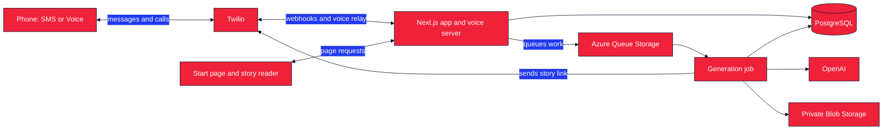

<p align="center">
  
</p>

<h1 align="center">Twilio Comics</h1>

<p align="center"><strong>Make a comic by text, text plus call, or in your browser.</strong></p>
<p align="center">Start with one or two reference photos, add your idea, and read or share the finished comic.</p>

<p align="center">
  
  
</p>

<p align="center">
  <a href="https://twilio-comics.kindriver-a0456aa8.eastus2.azurecontainerapps.io">Explore the pilot</a> ·
  <a href="#sample-pages">See sample pages</a> ·
  <a href="#how-it-works">How it works</a> ·
  <a href="#installation">Run locally</a>
</p>

> **Controlled pilot:** SMS and Voice are configured on **+1 866 901 2028**. A live inbound text and agent reply were delivered, but a real handset still needs to complete comic generation and result delivery on both channels. WhatsApp is disabled. Treat the number as a controlled pilot until those checks pass.

<details>
<summary>Pilot verification details</summary>

The Twilio CLI confirmed that the toll-free verified number supports SMS, MMS, and Voice, and that its SMS and Voice POST webhooks are configured. The public app advertises `sms,voice`. After the October 22 repair, a live inbound SMS reached the worker and its agent reply was delivered. On the earlier release, production admin credentials passed the login form; authenticated `/admin`, `/admin/activity`, and `/admin/users` requests returned HTTP 200, and the operator confirmed browser sign-in. The [admin dashboard](https://twilio-comics.kindriver-a0456aa8.eastus2.azurecontainerapps.io/admin/login) now uses the unversioned address. A signed `/relay` WebSocket handshake passed while an unsigned one was denied. These checks do not prove the full handset flows.

</details>

## Watch the illustrated film

<!-- Video hosted as a GitHub user attachment. -->

{{GITHUB_VIDEO_URL}}

*30-second illustrated concept. WhatsApp appears in the film but is disabled in the current pilot.*

## Sample pages

<p align="center">
  <a href="public/noir.jpg"></a>
  <a href="public/comic-book-next-scene-continuation.jpg"></a>
</p>
<p align="center"><sub>Sample art included in this repository. Generated pages vary by idea, style, and reference photos.</sub></p>

## How it works


- **Choose a way to play.** Open the [start page](https://twilio-comics.kindriver-a0456aa8.eastus2.azurecontainerapps.io/start) for SMS, SMS + Voice, and Browser Studio when each is enabled.
- **Make it yours.** Text one or two photos by MMS before using the phone agent, or take or upload photos directly in Browser Studio. Every new comic needs a photo.
- **Keep going.** Use `CONTINUE` within the 14-day conversation window to add another page to the story.
- **Share the result.** Phone comics arrive as a texted link. Browser comics appear on the page; texting yourself the link is optional. The story reader offers PDF download and sharing controls.

If this project is useful, [star the repository](https://github.com/anthonyplusAI/twilio-comics).

Twilio Comics builds on [Make Comics](https://github.com/Nutlope/make-comics). Thanks to its original creators and contributors for the foundation.

---

**Developer guide:** [Architecture](#architecture) · [Detailed usage](#usage) · [Installation](#installation) · [Twilio setup](#twilio-setup) · [Deployment](#deployment)

## Architecture

This is the main path from a phone conversation to a finished comic. Recovery, migrations, admin tools, and optional short links are described below.



The production Azure Container App hosts Next.js, signed Twilio webhooks, and the `/relay` ConversationRelay WebSocket. The warm web app handles the prefilled SMS opener, photo-only MMS receipts, and simple commands inline within an eight-second budget; slow attempts fall back to the durable queue. The event-driven Job handles other text turns and image generation from Azure Queue, with up to four executions in parallel. A second, scheduled Job republishes work left pending after a temporary failure. The three runtime workloads use one image; a separate migration image runs inside the private Azure network before a release. The private app network is in East US 2 and peers privately with a Central US PostgreSQL network; the database's private DNS zone is linked to both VNets. PostgreSQL and Blob Storage retain history across app revisions. `/api/healthz` reports the deployed commit and `/api/readyz` checks the migrated database.

## Usage

### How people start

The public homepage (`/`) opens the chooser at `/start`. It shows a tappable QR code by default; set `HOME_START_ENTRY_MODE=button` for a button only or `HOME_START_ENTRY_MODE=both` for both. Four selectable sample styles sit beneath the comic and rotate automatically; the page is designed to fit in a typical desktop viewport. `/start` offers up to three paths: SMS, SMS + Voice, and Browser Studio. The Voice action and QR open a photo-first guide at `/start/voice` before the person dials.

Set `TWILIO_ENABLED_CHANNELS` on the public Container App to choose the phone channels that can be used. The first-launch list is `sms,voice`. SMS + Voice appears only when both SMS and Voice are configured and the admin enables text-first calls. Browser Studio has a separate switch at `/admin/settings` and requires its server configuration. WhatsApp code remains available for a later launch but is not a `/start` choice in this three-path experience.

The current pilot uses `TWILIO_ENABLED_CHANNELS=sms,voice` and `TWILIO_PHONE_NUMBER=+18669012028`. The Twilio CLI confirmed this number belongs to the selected account, has `sms:true`, `mms:true`, and `voice:true`, reported toll-free SMS status `TWILIO_APPROVED`, and verified the SMS and Voice POST webhook settings. The public `/start` page offers the two channel actions. Complete the handset tests above before a broad announcement. The app cannot detect Twilio approval from its local configuration.

When `TWILIO_ENABLED_CHANNELS` is **unset or empty**, no phone channel is advertised or accepted. Voice additionally needs the Verify service, Relay URL, and signing secret. Browser Studio appears when the admin switch is on and the public origin, signing secrets, OpenAI key, and Blob storage are configured. Players do not need Google or a phone number to create in Browser Studio. If no path is available, `/start` says “opening soon.” These checks read local settings; they do not discover sender approvals from Twilio Console. Verify each selected sender and webhook in Twilio before promoting the page. The example `+15551234567` is never a live destination.

| Example selection | Options on `/start` | Required destination |
|---|---|---|
| `sms` | SMS, with a text action and QR | `TWILIO_PHONE_NUMBER` with SMS and MMS capability |
| `sms,voice` | SMS and SMS + Voice when text-first calls are enabled | `TWILIO_PHONE_NUMBER` with SMS, MMS, Voice, outbound SMS, Verify, and secure Relay URL |
| Explicit empty value | No phone option; Browser Studio may still appear | None for phone channels |
| Browser Studio switch on | Browser Studio when its runtime is ready | Public origin, Auth.js and media signing secrets, OpenAI key, and Blob storage |

| Channel | Where the idea arrives | Where the result goes |
|---|---|---|
| SMS/MMS | Text the Twilio number; `/api/twilio/sms` receives the webhook | Link to the branded story page by SMS |
| Voice | Call the Twilio number; enter the six-digit SMS code by keypad before `/relay` starts ConversationRelay | Link to the branded story page by SMS after the call |
| Browser Studio | Take or upload photos, enter the idea, and generate in `/studio` | The comic opens in the browser; an optional verified SMS sends its link |

Ordinary SMS/MMS uses Twilio's signed inbound webhook; it does not ask the sender for a code. Twilio Verify sends the six-digit code for Voice calls and for the optional “Text me the comic” action in Browser Studio.

### Public website

The homepage uses the Twilio bug in the header and favicon, a red, white, blue, and navy palette, and a matching social preview image. Its start QR opens `/start`; the control can instead be a button or both via `HOME_START_ENTRY_MODE`. The compact footer credits Twilio and the original [Make Comics](https://github.com/Nutlope/make-comics) project. The page styles are in `app/marketing.module.css`, and the social preview is in `app/opengraph-image.tsx`.

`/start` shows a card and QR code for each ready path. The SMS action opens a draft with **“Turn me into a comic!”** suggested; the person must send at least one portrait or character photo before approving a new comic. Opening a draft alone does not contact Twilio. The SMS + Voice card opens `/start/voice`, which asks the person to text one or two photos, wait for “Photo saved,” then call from the same number. Browser Studio appears when its admin switch and runtime are ready. The shared notice and policy links appear on `/start` and in the footer. If no path is ready, `/start` shows “opening soon.”

The app has its own `/privacy` and `/terms` routes. Their initial operator and support contact are **Anthony Dellavecchia** and **adellavecchia@twilio.com**, as supplied for this project. `APP_OPERATOR_NAME` and `APP_CONTACT_EMAIL` can override them if ownership changes; explicitly empty values show a draft notice. The operator must review the policy text before opening public channels or submitting the URLs for toll-free verification. The footer also links to [Twilio's website privacy notice](https://www.twilio.com/en-us/legal/privacy) and [Twilio's terms](https://www.twilio.com/en-us/legal/tos) as **provider policies**; those do not describe the operator's own comic service.

The browser composer lives at `/studio` and appears as its own `/start` option only when an admin opens Browser Studio. A player takes or uploads one or two reference photos, enters an idea, chooses a style with sample images, and generates with the server's OpenAI key. No Google sign-in or phone number is needed. The comic opens at `/story/{slug}` and can optionally be texted to a verified phone number when SMS and Verify are configured. The signed browser session lets the player find their comics for up to 30 days on that device. Editing and optional texting work while Studio is open; a saved story link remains viewable after it closes.

### Conversation flow

For SMS, send the suggested **“Turn me into a comic!”** message, text an idea directly, or send one or two photos first. Any of these starts a draft; at least one reference photo is required before approving a new comic. **`NEW`** resets the draft and asks for fresh photos. A photo-only MMS is saved and the agent asks for the idea. A name is optional. **`START`** is Twilio's opt-in keyword for a number that previously opted out, not the comic command. For Voice, text one or two photos first and wait for “Photo saved”; then call from the same phone within 24 hours. A new-comic call without a saved photo gives photo instructions before sending a code; saved continuations and in-progress jobs can still be checked. With a saved photo, Twilio Verify sends a six-digit text; the caller enters it on the keypad. The agent acknowledges the photo, discusses the idea, reads back a recap, accepts changes, and waits for spoken **“create it.”** Before offering approval, it screens the proposed visual prompt and asks for a change when it detects a likely block. Screening is a best-effort check; the image service can still decline an output or reference photo. A blocked draft requires a revised idea before approval can be offered again; temporary failures keep the saved draft ready for a retry. Each approval requests one five-panel page. The first approval starts a story; **`CONTINUE`** adds a page using the previous page as a visual reference. **`STATUS`** checks progress; **`DISCARD`** drops an unsubmitted text draft (say “cancel” on a call). A spoken reset ends the call and tells the caller to send fresh photos before calling again. The same agent logic powers the phone channels, with a saved draft per channel and phone number. SMS opt-out, opt-in, and help keywords are handled by Twilio rather than by the comic agent.

The result message contains a link to the full story, without an MMS image preview by default. Phone-made stories open a branded, mobile-friendly reader with all finished pages above the PDF download and sharing controls. The device share sheet, X, LinkedIn, or a link copied for an Instagram Story are available. X prepares a post with `@twilio` and `#Twilio`; the LinkedIn action copies a caption containing `@Twilio` and `#Twilio`. To make `@Twilio` an actual LinkedIn Page tag, the person retypes it and selects Twilio's Page from LinkedIn's mention list. LinkedIn's public URL share action cannot set a Page mention automatically. Instagram requires the person to complete their own post. Anyone who knows or guesses a short story link can view its pages, so share it deliberately; no phone number or user ID belongs in its URL. A Google sign-in is a separate identity, so signing in does not automatically grant edit rights to a phone-created story.

### Short comic links

When `DUB_API_KEY`, `DUB_DOMAIN`, and `DUB_FOLDER_ID` are all configured on the generation Job, the worker creates a Dub link in that folder for a finished channel story and sends it to the person. The destination is the existing `/story/{slug}` reader: each comic does not need its own deployment or server process. The story keeps the Dub link ID, key, and URL in PostgreSQL so later result, `STATUS`, and share actions can reuse it. If Dub is not completely configured or a link request fails, the worker sends the canonical branded story URL so delivery can continue. `RESULT_MEDIA_PREVIEW_ENABLED=true` on the generation Job is an opt-in for the older MMS preview; leave it unset or `false` for link-only results. Inbound MMS photos remain supported.

Save the Dub API key in an owner-only `.env.local` file as `DUB_API_KEY=...`, then run `bash scripts/configure-dub-runtime.sh` while signed in to the approved Azure subscription. The script finds or creates the `Twilio Comics` folder, stores the key in Azure Key Vault, and configures the generation Job for `twil.io` and link-only result messages. `pnpm dub:setup-folder` is available when only the folder ID is needed. [Dub's link creation API](https://dub.co/docs/api-reference/links/create) accepts a folder ID and custom domain. The workspace must first have the chosen domain [configured and verified](https://dub.co/help/article/how-to-add-custom-domain). The operator has confirmed `twil.io` is verified in Dub; test a real redirect before relying on it. Dub's [current plan comparison](https://dub.co/pricing/links) lists link folders on Pro and higher plans; check its limits before using one link per comic.

New short links use `comic-` followed by five random digits. They are public and easy to guess: anyone who knows or guesses a code can view the comic, including any likenesses generated from reference photos. Do not submit photos you need to keep private. Older issued links keep their original, longer keys. Used codes remain reserved after a comic is deleted so an old message can never open a different person's comic. A verified deletion request must also remove the corresponding Dub redirect; see the [data deletion procedure](docs/DATA_DELETION.md).

After a finished comic, text another idea or send **`NEW`** to make a separate comic; send **`CONTINUE`** within 14 days to add another page to the same one. **`NEW`**, **`RESET`**, and **`RESTART`** clear the current SMS and Voice drafts for the same phone, including their old photos; **`DISCARD`** drops an unsubmitted draft (say “cancel” on a call). If a comic is already generating, the fresh start takes effect after its result. Photos attached to the reset MMS can start the fresh draft; otherwise send new photos before approval. These commands do not erase finished comics, admin history, or the quota already used by phone-generated comics. A verified request to erase retained records follows the [data deletion procedure](docs/DATA_DELETION.md), not a conversation command.

### Photos for text and Voice comics

An admin enables or closes **SMS + Voice** at `/admin/settings`. A person sends one or two photos by MMS, waits for “Photo saved,” then calls from that same number within 24 hours. The app checks for a usable saved photo before sending the call's Verify code and again before starting the agent. The text and Voice drafts remain separate until that verified call imports the photos; a photo from another number, an old photo, or a finished SMS draft is not imported. The SMS photo-only stage remains available if the caller hangs up and is consumed only after a Voice comic using those photos is accepted. The caller gives the comic idea by voice and receives the result link by SMS. New Voice comics cannot be made without a reference photo; a finished comic can still be continued using its previous page.

The old phone-linked browser photo page is retired. `/start/camera` redirects to Browser Studio when it is open and ready, otherwise to `/start`. New code requests and uploads through the old camera APIs are closed. Photos already staged through that page can still be used by the same phone's SMS or Voice draft during their original 24-hour window, then expire from the handoff path. Browser Studio now handles camera capture and file upload directly for browser-made comics.

## How Pages Are Made

OpenAI `gpt-image-2` is prompted to generate a five-panel page from the approved idea and selected style. When the user supplies character photos or continues a story, the app passes those references, including the prior page when available, to the image edit API for visual continuity. A text model supplies the story title and description. The full image is saved in private Azure Blob Storage; the default outbound SMS contains a link to the branded reader. The optional MMS preview uses a smaller image when enabled.

## Stack

- Next.js 16 and React 19
- Signed Browser Studio sessions; Auth.js with Google OAuth for administrators
- Azure Database for PostgreSQL Flexible Server and Drizzle ORM
- OpenAI `gpt-image-2` for pages and a configurable text model for the agent and story metadata
- Azure Blob Storage for uploaded and generated images
- Azure Queue Storage, an event-driven Container Apps Job, and a scheduled recovery Job
- Twilio Programmable Messaging for SMS and ConversationRelay for Voice; WhatsApp is an optional later channel
- jsPDF for PDF export from the story page
- GitHub Actions, Azure OIDC, Azure Container Registry, and Azure Container Apps

## Installation

1. Install Node.js 22 and pnpm 10.20.0, then run `pnpm install`.
2. Copy `.example.env` to `.env` and fill in OpenAI, PostgreSQL, Auth.js, Azure Storage, and Twilio values needed for the channels you will test. Google OAuth credentials are needed only for Google admin sign-in; the operator password works without them. The example starts with an empty `TWILIO_ENABLED_CHANNELS` and Browser Studio closed. Open channels only when their sender, webhook, Verify service, and relay configuration are ready. Enable Browser Studio separately in `/admin/settings` after its runtime is configured. Review `APP_OPERATOR_NAME`, `APP_CONTACT_EMAIL`, and the legal page text. Use a local development database; production uses private Azure PostgreSQL.
3. For a new empty database, run `pnpm db:migrate`. For an existing database, read the [migration gate](docs/DEPLOYMENT.md#database-migration-gate) before running file-based migrations.
4. Start the browser-only Next.js server with `pnpm dev` to inspect the marketing page, `/start`, and `/studio`, or run `pnpm dev:voice` for Next.js **and** `/relay` on port `8080`. The latter is the local equivalent of the production `pnpm start` entrypoint.

To preview the closed state, leave `TWILIO_ENABLED_CHANNELS` empty and check that the homepage QR opens `/start`. If Studio is also unavailable, `/start` says “opening soon” without a live action or QR code. Set `HOME_START_ENTRY_MODE=button` or `both` to check the other homepage layouts. To preview live paths, configure real senders and an explicit channel list, then check that `/start` shows only ready options and that each action and QR destination matches its path. At a phone width, test the tap targets; from desktop, scan the QR codes. SMS should open a draft addressed to the configured number with “Turn me into a comic!” suggested; attach and send a reference photo before approval. Voice should open `/start/voice`, which guides the photo text, call, code, idea, and approval sequence. Set `TWILIO_ENABLED_CHANNELS=sms` for an SMS-only number; an unset list stays closed. Do not use the example number as a live destination.

To test inbound Twilio webhooks and calls locally, expose the `pnpm dev:voice` port through an HTTPS tunnel that supports WebSocket upgrades. Set `PUBLIC_BASE_URL` to its exact HTTPS origin. When testing Voice, set `TWILIO_VERIFY_SERVICE_SID` to a configured SMS Verify service and `CONVERSATION_RELAY_WS_URL` to the tunnel's `wss://` `/relay` URL. If using Google OAuth through that origin, set `AUTH_URL` and its Google callback to the same origin. Run `pnpm start:worker` to process one queued item locally; Azure runs this command for each Job execution in production.

For local Azure Storage development, run Azurite, create the private Blob container and both queues, and set:

```env
AZURE_STORAGE_CONNECTION_STRING=UseDevelopmentStorage=true
AZURE_STORAGE_CONTAINER_NAME=comics
AZURE_STORAGE_QUEUE_NAME=comic-generation
AZURE_STORAGE_POISON_QUEUE_NAME=comic-generation-poison
```

The Blob container remains private. The application serves HMAC-signed media URLs that OpenAI, Twilio, and shared story pages can retrieve without exposing the storage account directly. Blob names are generated by the server.

## Authentication

Browser Studio issues a signed session cookie to a player without requiring Google sign-in or a phone number. That session owns their uploaded photos and comics, and expires after 30 days. `/admin/login` supports both the operator username/password and Google sign-in for any verified `@twilio.com` Google Workspace account. The server requires Google's verified email, exact `@twilio.com` address, and `hd=twilio.com` hosted-domain claim before granting admin access. The domain hint sent to Google does not grant access by itself. Google credentials are needed only if the operator uses Google admin sign-in; configure this callback for each origin in the Google OAuth Web client:

```text
http://localhost:3000/api/auth/callback/google
https://twilio-comics.kindriver-a0456aa8.eastus2.azurecontainerapps.io/api/auth/callback/google
```

Admin Google sign-in variables:

```env
AUTH_SECRET=
AUTH_GOOGLE_ID=
AUTH_GOOGLE_SECRET=
AUTH_URL=https://YOUR_DOMAIN
```

The Google button is hidden until both `AUTH_GOOGLE_ID` and `AUTH_GOOGLE_SECRET` are set on the web app; the operator password remains available. Auth.js stores stable admin users and Google account links in PostgreSQL. Browser Studio uses the existing server OpenAI key. The admin switch defaults off; when on, Browser Studio has no weekly generation count limit for a player. Rolling hourly and daily admission limits, concurrency, and upload controls protect the shared key. Twilio phone addresses resolve to separate internal channel identities rather than being used directly as story owner IDs.

## Twilio Setup

The pilot number uses these **HTTP POST** webhooks at the exact public HTTPS origin in `PUBLIC_BASE_URL`:

```text
SMS/MMS:  https://twilio-comics.kindriver-a0456aa8.eastus2.azurecontainerapps.io/api/twilio/sms#rc=3&rp=5xx,ct,rt
Voice:    https://twilio-comics.kindriver-a0456aa8.eastus2.azurecontainerapps.io/api/twilio/voice#rc=3&rp=5xx,ct,rt
```

If WhatsApp is enabled later, its sender uses `https://YOUR_DOMAIN/api/twilio/whatsapp#rc=3&rp=5xx,ct,rt` as the HTTP POST webhook.

The fragment is Twilio's optional [HTTP webhook retry configuration](https://www.twilio.com/docs/usage/webhooks/webhooks-connection-overrides). Twilio omits it from signature calculation. Each inbound `MessageSid` is stored once, so a retry does not request another comic. The application validates Twilio signatures for the inbound webhooks and automatically configures signed `/api/twilio/voice/action` and `/api/twilio/status` callbacks. You do not set those callbacks on the phone number.

ConversationRelay is configured to connect to this WebSocket URL, **without** the HTTP retry fragment:

```text
wss://twilio-comics.kindriver-a0456aa8.eastus2.azurecontainerapps.io/relay
```

Voice first sends a six-digit SMS code through a configured [Twilio Verify service](https://www.twilio.com/docs/verify/api). The caller enters it through Twilio `<Gather input="dtmf">`; only an approved code opens ConversationRelay. The code never enters speech transcription or the comic prompt. Set `TWILIO_VERIFY_SERVICE_SID` on the public app and configure that service's SMS sender. The app limits code starts to four per hour and ten per rolling 24 hours per caller number. It allows six verified AI calls per caller in a rolling 24 hours. Each Relay call lasts at most ten minutes and twenty caller turns. This app uses ConversationRelay directly for speech and keeps the agent logic in the shared application. Twilio Agent Connect can be added later if the product needs its additional routing and agent services.

Browser Studio's optional **Text me the comic** action uses the same Verify service to confirm the player's chosen number before sending its link. Creating and reading a browser comic does not require a phone number. A Voice call still has its own verification step.

Set `TWILIO_PHONE_NUMBER` to the real E.164 number used for selected SMS or Voice channels. The pilot sender is `+18669012028`, with `TWILIO_ENABLED_CHANNELS=sms,voice` on the public app. Its SMS action and QR destination are `sms:+18669012028?body=Turn%20me%20into%20a%20comic!`; the call destination is `tel:+18669012028`. The SMS link drafts the suggested opener and requires the user to tap Send, replace it with an idea, or attach photos and send. SMS needs a text-capable number; SMS + Voice also needs a call-capable number that can send outbound SMS results. To offer WhatsApp through its existing webhook in a later release, set `TWILIO_WHATSAPP_NUMBER` to an approved sender with the `whatsapp:` prefix and update the public start experience. An empty or unset channel list closes phone actions and inbound conversations, while Browser Studio may remain available. Setting the variable does not provision a number, approve SMS messaging, or configure Twilio webhooks. Voice callers receive the result link by SMS at their caller number. The example `+15551234567` is a placeholder and must not appear in a live call to action.

The Twilio CLI reported this number's [toll-free SMS verification](https://www.twilio.com/docs/messaging/compliance/toll-free/console-onboarding) as `TWILIO_APPROVED`, confirmed SMS, MMS, and Voice capabilities, and verified both inbound POST webhooks on October 22, 2026. An inbound SMS and the worker's delivered agent reply were confirmed after the [October 22 repair](docs/DEPLOYMENT.md#if-a-text-gets-no-reply). End-to-end handset MMS-photo intake, SMS and Voice comic generation, photo handoff, and result delivery still need confirmation. The inbound SMS webhook acknowledges a saved message without a synchronous reply; the Azure generation Job sends the agent's reply later. If a text receives no answer, follow the [SMS troubleshooting steps](docs/DEPLOYMENT.md#if-a-text-gets-no-reply). Review the app-specific `/privacy` and `/terms` pages and SMS disclosure before a broad announcement. Twilio's corporate policies are provider policies, not the operator's app policies. For Voice, confirm Twilio's [AI/ML Features Addendum](https://www.twilio.com/docs/voice/conversationrelay/onboarding) under Voice privacy settings. An A2P 10DLC campaign is for local 10-digit long-code senders, not this toll-free number.

## Reliability

- Twilio inbound messages are deduplicated by `MessageSid`; voice submissions use the call ID and approved turn.
- The text worker reserves at most 20 agent turns per phone per hour and 80 per rolling 24 hours across SMS and WhatsApp. It sends one limit notice per channel per 24 hours, then records and silently closes later denials. A separate 100-inbound-receipt UTC-day guard applies per sender and channel, and sends only its first notice. If PostgreSQL cannot reserve a turn, the worker retries without calling OpenAI.
- Signed Voice setup must carry a short-lived authorization for the exact call after SMS keypad verification. It cannot load a saved draft before that check.
- Queue messages contain only a version and receipt or job ID; prompts and recipient data remain in PostgreSQL.
- The text worker saves turns and replies in PostgreSQL and processes them in order under a conversation lease.
- SMS, WhatsApp, and Voice drafts and story continuation state reset after 14 days without interaction, once any active generation job completes. A weekly quota denial leaves the draft available through the seven-day quota window. The result message gives the user the 14-day continuation window. Earlier messages, transcripts, and comics remain in admin history until explicit deletion.
- Generation jobs use Postgres leases and deterministic story/page/blob IDs.
- Free-tier quotas are reserved atomically before server-funded generation.
- Phone-generated comics default to three app-funded generation requests per player per rolling seven days; an admin can change or remove that phone player's limit. Failed requests without a saved comic release their slot. Browser Studio has no weekly generation count limit while the admin switch is on; rolling generation starts, concurrent generation, session issuance, and upload limits protect the shared server key. A channel job can make up to three image attempts, and retries of the same job do not create another request. Provider-side spending limits remain important.
- Queue retries reuse completed database/blob checkpoints. The scheduled recovery Job re-enqueues stale work every five minutes.
- Outbound result messages contain a story link by default. If the optional MMS preview is enabled, outbound media is resized for MMS; a preview failure still sends the story link, and signed Twilio delivery-status callbacks can attempt a link-only fallback after a failed media delivery. A link-only SMS that fails with Twilio error 30008 gets one short link-only retry; `STATUS` can also retrieve a saved result.
- Comic result and failure texts stop after the generation request is 24 hours old; an expired request clears its active phone draft while its job and story stay in admin history. SMS/MMS queue requests also set a bounded [Twilio validity period](https://www.twilio.com/docs/messaging/api/message-resource). A carrier delivery already in progress cannot be recalled.

## Admin metrics and history

An admin signs in at `/admin/login` with the shared operator username/password or a verified Twilio Workspace Google account. `/admin/settings` opens or closes Browser Studio, opens or closes text-first SMS + Voice, and provides a **Change admin login** form for the shared password login. The settings and rotated login live in PostgreSQL, so a deploy does not reset them. `/admin` shows metrics for messages, limited message turns, answered and rate-limited calls, comic requests, completions, and delivery, plus a daily trend and recent events. Its date control can show all time, today, the last 7 or 30 days, or a custom inclusive UTC date range. The same selection applies to dashboard counts and recent activity; the chart shows up to the last 14 days within that selection. A selected-period phone participant count means newly recorded phone identities during that period. The dashboard also counts agent text replies that Twilio marked failed or undelivered by distinct outbound Message SID. `/admin/activity` pages through the full activity history, including historical camera photo events, and offers the same date presets and custom range alongside a **Failed agent replies** filter. Date filters remain selected while paging through activity. `/admin/users` searches participants by phone, name, email, or ID; a participant page shows a paginated event timeline and recent raw records. These views include identifiable messages, finalized voice transcript text, prompts, results, and delivery details, so every eligible Twilio Workspace account receives access to that history when Google sign-in is enabled.

At `/admin/users`, open a phone participant record to set **Comic generation allowance**. The default is three app-funded generations per rolling seven days. An admin can choose a custom whole-number limit from 0 to 10,000 or **Unlimited**; 0 pauses app-funded generation for that player. Changes apply immediately to the current quota window. A phone identity shares its allowance across SMS, WhatsApp, and Voice. Browser Studio has no weekly allowance while the public switch is on; rolling hourly and daily limits still apply to generation starts.

There is no default login. [`scripts/configure-runtime-secrets.sh`](scripts/configure-runtime-secrets.sh) generated `AUTH_SECRET`, `MEDIA_SIGNING_SECRET`, and an initial admin password, then stored them in Azure Key Vault without printing the raw values. It stores the operator's initial password copy in Key Vault and wires only its scrypt hash to the web app as `ADMIN_PASSWORD_HASH`; the initial `ADMIN_USERNAME` is `comics-admin`. The production OpenAI API key and Twilio Auth Token are also bound through Key Vault secret references. To set a new admin username and password, sign in and use **Change admin login** in `/admin/settings`; the [short guide](docs/ADMIN_CREDENTIALS.md) explains the steps and how to recover a lost login without the old password. The new salted password hash is stored in private Azure PostgreSQL and immediately invalidates password-authenticated admin sessions. Google admin sessions remain valid until their two-hour expiry. The old Key Vault password copy remains the initial password and will no longer sign in after a dashboard change. See [runtime setup](docs/INFRA_SETUP.md#configure-runtime-before-the-first-release) for initial credential retrieval. The production login form accepted the initial credential in an automated check, the three protected dashboard routes returned HTTP 200, and the operator confirmed browser sign-in. For manual development setup, `pnpm exec tsx scripts/hash-admin-password.ts` accepts a hidden password entry and prints its encoded hash. The raw password must not be stored in the repository. `AUTH_SECRET` signs short-lived admin sessions. The dashboard reads PostgreSQL tables rather than container files, so a new Azure image or revision does not erase history. Stored history has no automatic expiry. A verified user deletion request must be handled explicitly across database records and associated images; do not assume deleting an account row removes the append-only event content.

Admin password attempts are throttled by the client address appended by Azure Container Apps ingress. The public app must stay behind ACA HTTP ingress for production sign-in; a different ingress needs an equivalent trusted client-address integration. Use the [data deletion runbook](docs/DATA_DELETION.md) to inventory a verified phone participant before removing retained database and Blob records.

## Deployment

Azure deployment is gated by the reusable `Validate` CI check and the explicit `PRODUCTION_RELEASE_READY=true` repository variable, which is currently set. CI builds both the runtime and migration Dockerfiles. A successful release runs the private database migration Job, updates the web Container App and both runtime Jobs, and checks public `/api/healthz` and database-backed `/api/readyz`. The full public app has external HTTPS ingress at [the pilot site](https://twilio-comics.kindriver-a0456aa8.eastus2.azurecontainerapps.io); its Twilio SMS and Voice POST webhooks are verified and `TWILIO_ENABLED_CHANNELS=sms,voice`. WhatsApp remains disabled. The operator has signed in to the admin dashboard. One inbound SMS and the delivered agent reply were confirmed after the October 22 repair; full SMS comic generation/delivery and the Voice handset flow remain launch checks. The setup script's initial empty channel list is a bootstrap state, not the current pilot setting.

The former `twilio-comics-v2` web address remains available only to redirect previously shared links. Private Azure resources retain historical `-v2` names, while the full app runs at the unversioned address.

- One-time Azure and GitHub setup: [`docs/INFRA_SETUP.md`](docs/INFRA_SETUP.md)
- Private PostgreSQL network and migration setup: [`docs/AZURE_POSTGRES.md`](docs/AZURE_POSTGRES.md)
- Early launch Azure cost estimate: [`docs/AZURE_COSTS.md`](docs/AZURE_COSTS.md)
- Admin username and password rotation: [`docs/ADMIN_CREDENTIALS.md`](docs/ADMIN_CREDENTIALS.md)
- Deployment behavior and operations: [`docs/DEPLOYMENT.md`](docs/DEPLOYMENT.md)
- CI checks and dependency updates: [`docs/CICD.md`](docs/CICD.md)

## Commands

| Command | Purpose |
|---|---|
| `pnpm dev` | Start local Next.js development |
| `pnpm dev:voice` | Start local Next.js and the ConversationRelay WebSocket |
| `pnpm build` | Build the production application |
| `pnpm start` | Run the production web/voice server |
| `pnpm start:worker` | Process one Azure Queue item; with `RECOVERY_MODE=1`, run a recovery sweep |
| `pnpm test` | Run unit tests |
| `pnpm typecheck` | Run TypeScript validation |
| `pnpm lint` | Run ESLint |
| `pnpm dub:setup-folder` | Find or create the Dub `Twilio Comics` folder and print its ID |
| `pnpm db:migrate` | Apply checked-in migrations to an empty or baselined database |
| `pnpm drizzle-kit push` | Update a development database directly; baseline it before switching to migrations |

## License

This repository does not currently include a license file.
