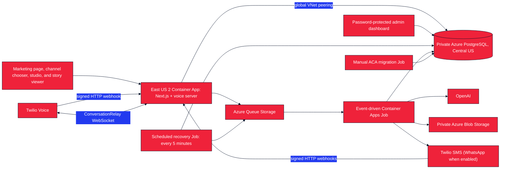

# Twilio Comics

Create AI-generated comic pages by texting an idea to a Twilio number or calling a Twilio ConversationRelay voice agent. The first launch is planned for SMS and Voice on **+1 866 901 2028**. The authenticated Twilio CLI reported toll-free status `TWILIO_APPROVED` on October 21, 2026; keep public actions closed until the live flows are tested. WhatsApp remains an optional later channel. The agent helps shape the idea, asks for approval, and sends the finished comic after an Azure worker generates it. The public website shows how to start and displays finished stories; its browser comic studio is retained for testing.

Twilio Comics is a fork of [Make Comics](https://github.com/Nutlope/make-comics). Thanks to its original creators and contributors for the foundation.

## Architecture



The production Azure Container App will host Next.js, signed Twilio webhooks, and the `/relay` ConversationRelay WebSocket. The event-driven Job handles inbound text turns and slow image generation from Azure Queue. A second, scheduled Job republishes work left pending after a temporary failure. The three runtime workloads use one image; a separate migration image runs inside the private Azure network before a release. The provisioned V2 app network is in East US 2 and peers privately with a Central US PostgreSQL network; the database's private DNS zone is linked to both VNets. PostgreSQL and Blob Storage retain history across app revisions. The V2 web app is still an internal prelaunch workload, not a public release.

## Usage

### How people start

The public homepage (`/`) invites people to make a comic and links to the dedicated channel chooser at `/start`. On a phone, each available option opens the corresponding experience: `sms:` opens a text, `https://wa.me/` opens WhatsApp, and `tel:` opens the dialer. On desktop, `/start` shows a QR code for each available channel so a person can scan the option they want with a phone. The chooser gives channel-specific steps. The same agent handles the comic conversation and sends a story link when it is ready.

Set `TWILIO_ENABLED_CHANNELS` on the public Container App to choose which options appear and can be used. The first-launch list is `sms,voice`; WhatsApp can be added later. Only listed channels with a valid configured destination appear on `/start`, in the listed order.

For the first launch, use `TWILIO_ENABLED_CHANNELS=sms,voice` with `TWILIO_PHONE_NUMBER=+18669012028` **only after** the Voice relay and SMS code check work, the app policies are reviewed, and the public webhooks and result delivery pass live tests. The Twilio CLI confirmed that this number belongs to the selected account and reported toll-free SMS status `TWILIO_APPROVED` on October 21, 2026. Leave `TWILIO_ENABLED_CHANNELS` empty during prelaunch. The app cannot detect Twilio approval from its local configuration.

When `TWILIO_ENABLED_CHANNELS` is **unset or empty**, no public channel is advertised or accepted. Only listed channels with valid destinations appear. Voice additionally stays hidden until the Verify service, Relay URL, account credentials, and signing secret are configured. With no available channel, `/start` says “opening soon” and offers no live contact action or QR code. This configuration reads local settings; it does not discover sender capabilities or approvals from Twilio Console. Verify each selected sender and webhook in Twilio before promoting the page. The example `+15551234567` is never a live destination.

| Example selection | Options on `/start` | Required destination |
|---|---|---|
| `sms` | Text an idea; SMS link, instructions, and QR | `TWILIO_PHONE_NUMBER` with SMS capability |
| `whatsapp` | Open WhatsApp; chat link, instructions, and QR | `TWILIO_WHATSAPP_NUMBER` |
| `voice` | Receive a texted code, enter it on the call keypad, then talk with ConversationRelay | `TWILIO_PHONE_NUMBER` with Voice **and outbound SMS**, plus `TWILIO_VERIFY_SERVICE_SID` and the secure Relay URL |
| `sms,voice` | First-launch text and call options, each with its own action and QR | `+18669012028` after Voice and end-to-end testing |
| `voice,whatsapp` | Call and WhatsApp options, in that order | Both destinations |
| Explicit empty value | “Opening soon,” without contact actions or QR codes | None |

| Channel | Where the idea arrives | Where the result goes |
|---|---|---|
| SMS/MMS | Text the Twilio number; `/api/twilio/sms` receives the webhook | Story link, with an MMS preview when available |
| WhatsApp, when enabled | Message the approved sender; `/api/twilio/whatsapp` receives the webhook | Story link, with an image preview when available |
| Voice | Call the Twilio number; enter the six-digit SMS code by keypad before `/relay` starts ConversationRelay | Story link by SMS after the call, with an MMS preview when available |

### Public website

The homepage uses the Twilio bug in the header and favicon, a red, white, blue, and navy palette, and a matching social preview image. Its start link opens `/start`, which presents the available channels with mobile-sized tap targets and a QR code for each option on desktop. SMS and Voice actions explain the automated messages, variable frequency, possible carrier charges, HELP/STOP, keypad verification, and SMS delivery after a Voice call. With no enabled channel, the site shows “opening soon” without a contact action or QR code. The footer credits the [Make Comics](https://github.com/Nutlope/make-comics) project. The page styles are in `app/marketing.module.css`, and the social preview is in `app/opengraph-image.tsx`.

The app has its own `/privacy` and `/terms` routes. Their initial operator and support contact are **Anthony Dellavecchia** and **adellavecchia@twilio.com**, as supplied for this project. `APP_OPERATOR_NAME` and `APP_CONTACT_EMAIL` can override them if ownership changes; explicitly empty values show a draft notice. The operator must review the policy text before opening public channels or submitting the URLs for toll-free verification. The footer also links to [Twilio's website privacy notice](https://www.twilio.com/en-us/legal/privacy) and [Twilio's terms](https://www.twilio.com/en-us/legal/tos) as **provider policies**; those do not describe the operator's own comic service.

The browser composer lives at `/studio` for manual testing and development. It is not linked as a public start action. Finished comics remain viewable at `/story/{slug}`, including from links sent by text. Creating a comic in the studio or editing a browser-owned story requires Google sign-in; phone users do not need a browser account to start or receive a comic.

### Conversation flow

Start with a comic idea; a name is optional. A Voice caller first receives a six-digit SMS code and enters it on the call keypad. The agent can ask a short follow-up question and accepts revisions. SMS and WhatsApp also accept up to two character photos, including photo-only messages. The agent summarizes a draft and waits for **`CREATE`** by text or **“create it”** by voice. Each approval requests one five-panel page; the app does not count panels in the generated image. The first approval starts a story; **`CONTINUE`** starts a draft for its next page in the same conversation channel. **`STATUS`** checks progress, **`DISCARD`** discards an unsubmitted text draft (say “cancel” on a call), and **`NEW`** starts a new story. While a page is generating, the draft stays locked until its job finishes. The same agent logic powers all channels, with a separate saved draft per number and channel. SMS opt-out, opt-in, and help keywords are handled by Twilio rather than by the comic agent.

The result message always includes a link to the full story. It also includes a compact image preview when available. A story made by phone can be viewed through that link. A Google sign-in is a separate identity, so signing in does not automatically grant edit rights to a phone-created story.

## How Pages Are Made

OpenAI `gpt-image-2` is prompted to generate a five-panel page from the approved idea and selected style. When the user supplies character photos or continues a story, the app passes those references, including the prior page when available, to the image edit API for visual continuity. A text model supplies the story title and description. The full image is saved in private Azure Blob Storage; the outbound message uses a smaller preview when available.

## Stack

- Next.js 16 and React 19
- Auth.js with Google OAuth
- Azure Database for PostgreSQL Flexible Server and Drizzle ORM
- OpenAI `gpt-image-2` for pages and a configurable text model for the agent and story metadata
- Azure Blob Storage for uploaded and generated images
- Azure Queue Storage, an event-driven Container Apps Job, and a scheduled recovery Job
- Twilio Programmable Messaging for SMS and ConversationRelay for Voice; WhatsApp is an optional later channel
- jsPDF for PDF export from the story page
- GitHub Actions, Azure OIDC, Azure Container Registry, and Azure Container Apps

## Installation

1. Install Node.js 22 and pnpm 10.20.0, then run `pnpm install`.
2. Copy `.example.env` to `.env` and fill in OpenAI, PostgreSQL, Auth.js, Azure Storage, and Twilio values needed for the channels you will test. Google OAuth credentials are needed only for the browser testing studio; production also requires `STUDIO_TESTER_EMAILS` for those testers. It starts with an empty `TWILIO_ENABLED_CHANNELS` so the public page remains closed while setup is incomplete. Change it to the channels you are testing only when their sender, webhook, Verify service, and relay configuration are ready. Review the supplied operator/contact in `APP_OPERATOR_NAME` and `APP_CONTACT_EMAIL` and the legal page text. Use a local development database; production uses private Azure PostgreSQL.
3. For a new empty database, run `pnpm db:migrate`. For an existing database, read the [migration gate](docs/DEPLOYMENT.md#database-migration-gate) before running file-based migrations.
4. Start the browser-only Next.js server with `pnpm dev` to inspect the marketing page, `/start`, and `/studio`, or run `pnpm dev:voice` for Next.js **and** `/relay` on port `8080`. The latter is the local equivalent of the production `pnpm start` entrypoint.

To preview the closed state, leave `TWILIO_ENABLED_CHANNELS` empty and check that `/` and `/start` show “opening soon” without a contact action or QR code. To preview live channels, configure real test senders and an explicit channel list, then check that `/start` shows only those options and that each action, QR destination, and set of steps matches its channel. Test the tap targets at a phone width and scan each QR code from desktop. Set `TWILIO_ENABLED_CHANNELS=sms` for an SMS-only number; an unset list stays closed. Do not use the example number as a live destination.

To test inbound Twilio webhooks and calls locally, expose the `pnpm dev:voice` port through an HTTPS tunnel that supports WebSocket upgrades. Set `PUBLIC_BASE_URL` to its exact HTTPS origin. When testing Voice, set `TWILIO_VERIFY_SERVICE_SID` to a configured SMS Verify service and `CONVERSATION_RELAY_WS_URL` to the tunnel's `wss://` `/relay` URL. If using Google OAuth through that origin, set `AUTH_URL` and its Google callback to the same origin. Run `pnpm start:worker` to process one queued item locally; Azure runs this command for each Job execution in production.

For local Azure Storage development, run Azurite, create the private Blob container and both queues, and set:

```env
AZURE_STORAGE_CONNECTION_STRING=UseDevelopmentStorage=true
AZURE_STORAGE_CONTAINER_NAME=comics
AZURE_STORAGE_QUEUE_NAME=comic-generation
AZURE_STORAGE_POISON_QUEUE_NAME=comic-generation-poison
```

The Blob container remains private. The application serves HMAC-signed media URLs that OpenAI, Twilio, and shared story pages can retrieve without exposing the storage account directly. Blob names are generated by the server.

## Authentication

Studio creation and browser-owned story editing use Auth.js with Google OAuth. The marketing page, `/start` chooser, story viewer, phone conversation, and password-protected admin dashboard do not require Google sign-in. Google credentials are optional unless you use `/studio`; when you do, configure this callback in Google Cloud:

```text
http://localhost:3000/api/auth/callback/google
https://YOUR_DOMAIN/api/auth/callback/google
```

Required variables:

```env
AUTH_SECRET=
AUTH_GOOGLE_ID=
AUTH_GOOGLE_SECRET=
AUTH_URL=https://YOUR_DOMAIN
STUDIO_TESTER_EMAILS=you@example.com
```

In production, `STUDIO_TESTER_EMAILS` is a comma-separated allowlist checked at sign-in and on each studio session. Leave Google OAuth unset if the browser studio is unused. Auth.js stores stable users and Google account links in PostgreSQL. Twilio phone addresses resolve to separate internal channel identities rather than being used directly as story owner IDs.

## Twilio Setup

Configure these first-launch **HTTP POST** webhooks using the exact public HTTPS origin in `PUBLIC_BASE_URL`:

```text
SMS/MMS:  https://YOUR_DOMAIN/api/twilio/sms#rc=3&rp=5xx,ct,rt
Voice:    https://YOUR_DOMAIN/api/twilio/voice#rc=3&rp=5xx,ct,rt
```

If WhatsApp is enabled later, its sender uses `https://YOUR_DOMAIN/api/twilio/whatsapp#rc=3&rp=5xx,ct,rt` as the HTTP POST webhook.

The fragment is Twilio's optional [HTTP webhook retry configuration](https://www.twilio.com/docs/usage/webhooks/webhooks-connection-overrides). Twilio omits it from signature calculation. Each inbound `MessageSid` is stored once, so a retry does not request another comic. The application validates Twilio signatures for the inbound webhooks and automatically configures signed `/api/twilio/voice/action` and `/api/twilio/status` callbacks. You do not set those callbacks on the phone number.

ConversationRelay connects to this WebSocket URL, **without** the HTTP retry fragment:

```text
wss://YOUR_DOMAIN/relay
```

Voice first sends a six-digit SMS code through a configured [Twilio Verify service](https://www.twilio.com/docs/verify/api). The caller enters it through Twilio `<Gather input="dtmf">`; only an approved code opens ConversationRelay. The code never enters speech transcription or the comic prompt. Set `TWILIO_VERIFY_SERVICE_SID` on the public app and configure that service's SMS sender. The app limits code starts to four per hour and ten per 24 hours per caller number, plus twelve per hour and forty per day across the app number. It allows six verified AI calls per caller in a rolling 24 hours. Each Relay call lasts at most ten minutes and twenty caller turns. This app uses ConversationRelay directly for speech and keeps the agent logic in the shared application. Twilio Agent Connect can be added later if the product needs its additional routing and agent services.

Set `TWILIO_PHONE_NUMBER` to the real E.164 number used for selected SMS or Voice channels. The planned first-launch sender is `+18669012028`. SMS needs a text-capable number; Voice needs a call-capable number that can also send outbound SMS results to callers. To offer WhatsApp later, set `TWILIO_WHATSAPP_NUMBER` to an approved sender with the `whatsapp:` prefix. Set `TWILIO_ENABLED_CHANNELS` on the public app to `sms,voice` for the first launch, or leave it empty during prelaunch. Available channels appear in that order on `/start`, each with its own contact action and desktop QR code. Unset also means closed. Setting the variable does not provision a number, approve SMS messaging, or configure Twilio webhooks. Voice callers receive the result by SMS, with an MMS preview when available, at their caller number. The example `+15551234567` is a placeholder and must not appear in a live call to action.

The Twilio CLI reported this number's [toll-free SMS verification](https://www.twilio.com/docs/messaging/compliance/toll-free/console-onboarding) as `TWILIO_APPROVED` on October 21, 2026. Recheck the status and test outbound SMS before opening the channels; Voice callers also receive their results by SMS. Review the app-specific `/privacy` and `/terms` pages and SMS disclosure before launch. Twilio's corporate policies are provider policies, not the operator's app policies. For Voice, accept Twilio's [AI/ML Features Addendum](https://www.twilio.com/docs/voice/conversationrelay/onboarding) under Voice privacy settings. An A2P 10DLC campaign is for local 10-digit long-code senders, not this toll-free launch number.

## Reliability

- Twilio inbound messages are deduplicated by `MessageSid`; voice submissions use the call ID and approved turn.
- The text worker reserves at most 20 agent turns per phone per hour and 80 per rolling 24 hours across SMS and WhatsApp. It sends one limit notice per channel per 24 hours, then records and silently closes later denials. The existing 100-inbound-receipt UTC-day guard also sends only its first notice. If PostgreSQL cannot reserve a turn, the worker retries without calling OpenAI.
- Signed Voice setup must carry a short-lived authorization for the exact call after SMS keypad verification. It cannot load a saved draft before that check.
- Queue messages contain only a version and receipt or job ID; prompts and recipient data remain in PostgreSQL.
- The text worker saves turns and replies in PostgreSQL and processes them in order under a conversation lease.
- SMS, WhatsApp, and Voice drafts and story continuation state reset after 14 days without interaction, once any active generation job completes. A weekly quota denial leaves the draft available through the seven-day quota window. The result message gives the user the 14-day continuation window. Earlier messages, transcripts, and comics remain in admin history until explicit deletion.
- Generation jobs use Postgres leases and deterministic story/page/blob IDs.
- Free-tier quotas are reserved atomically before server-funded generation.
- `DAILY_GENERATION_JOB_LIMIT` admits at most 25 app-funded comic requests per UTC day by default, shared by SMS, WhatsApp, Voice, and browser studio requests using the app's OpenAI key; `0` pauses these requests. A failed or retried channel job keeps one slot from its admission day, and a job can make up to three image attempts. Studio testers using their own API keys do not use app-funded capacity. This is an admission limit, not a strict provider spending cap.
- Queue retries reuse completed database/blob checkpoints. The scheduled recovery Job re-enqueues stale work every five minutes.
- Outbound media is resized for MMS. If preview creation fails, the worker still sends the story link; signed Twilio delivery-status callbacks record later failures and attempt a link-only fallback.
- Comic result and failure texts stop after the generation request is 24 hours old; suppressed sends stay in admin history. SMS/MMS queue requests also set a bounded [Twilio validity period](https://www.twilio.com/docs/messaging/api/message-resource). A carrier delivery already in progress cannot be recalled.

## Admin metrics and history

An operator signs in at `/admin/login` with a configured username and password, separate from Google OAuth. `/admin` shows lifetime and recent activity metrics for messages, limited message turns, answered and rate-limited calls, comic requests, completions, and delivery, plus a daily trend and recent events. It also counts agent text replies that Twilio marked failed or undelivered by distinct outbound Message SID. `/admin/activity` pages through the full activity history and offers a **Failed agent replies** filter for those delivery records. `/admin/users` searches participants by phone, name, email, or ID; a participant page shows a paginated event timeline and recent raw records. These views include identifiable messages, finalized voice transcript text, prompts, results, and delivery details, so only the operator should have the credentials.

There is no default login. For V2, [`scripts/configure-runtime-secrets.sh`](scripts/configure-runtime-secrets.sh) generates `AUTH_SECRET`, `MEDIA_SIGNING_SECRET`, and an initial admin password, then stores them in Azure Key Vault without printing the raw values. It stores the initial password for operator retrieval and wires only its scrypt hash to the web app as `ADMIN_PASSWORD_HASH`; the default `ADMIN_USERNAME` is `comics-admin`. The same script binds any supplied OpenAI API key and Twilio Auth Token through owner-only input files, and leaves public ingress and channels closed. See [runtime setup](docs/INFRA_SETUP.md#configure-v2-runtime-before-the-first-release) for the exact command and password retrieval. For manual development setup, `pnpm exec tsx scripts/hash-admin-password.ts` accepts a hidden password entry and prints its encoded hash. The raw password must not be stored in the repository. `AUTH_SECRET` signs short-lived admin sessions. The dashboard reads PostgreSQL tables rather than container files, so a new Azure image or revision does not erase history. Stored history has no automatic expiry. A verified user deletion request must be handled explicitly across database records and associated images; do not assume deleting an account row removes the append-only event content.

Admin password attempts are throttled by the client address appended by Azure Container Apps ingress. The public app must stay behind ACA HTTP ingress for production sign-in; a different ingress needs an equivalent trusted client-address integration. Use the [data deletion runbook](docs/DATA_DELETION.md) to inventory a verified phone participant before removing retained database and Blob records.

## Deployment

Azure deployment is gated by the reusable `Validate` CI check and the explicit `PRODUCTION_RELEASE_READY=true` repository variable. That release gate remains closed during this prelaunch setup. CI builds both the runtime and migration Dockerfiles. A ready release builds immutable runtime and migration images, runs the database migration Job through the private peered Azure networks, updates the web Container App and both runtime Jobs, and smoke-tests `/api/healthz` plus the database-backed `/api/readyz`. The V2 placeholder app has internal ingress and zero minimum replicas; the release exposes it only after a healthy digest-pinned revision. Keep the release variable unset until the private database roles and migration, Key Vault runtime secrets, public origin, Twilio webhook cutover, and live SMS and Voice checks are complete. The setup script keeps channels empty; setting the release variable or deploying the app alone does not enable SMS or Voice.

- One-time Azure and GitHub setup: [`docs/INFRA_SETUP.md`](docs/INFRA_SETUP.md)
- Private PostgreSQL network and migration setup: [`docs/AZURE_POSTGRES.md`](docs/AZURE_POSTGRES.md)
- Early launch Azure cost estimate: [`docs/AZURE_COSTS.md`](docs/AZURE_COSTS.md)
- Deployment behavior and operations: [`docs/DEPLOYMENT.md`](docs/DEPLOYMENT.md)
- CI checks and dependency updates: [`docs/CICD.md`](docs/CICD.md)

## Commands

| Command | Purpose |
|---|---|
| `pnpm dev` | Start local Next.js development |
| `pnpm dev:voice` | Start local Next.js and the ConversationRelay WebSocket |
| `pnpm build` | Build the production application |
| `pnpm start` | Run the production web/voice server |
| `pnpm start:worker` | Process one Azure Queue item; with `RECOVERY_MODE=1`, run a recovery sweep |
| `pnpm test` | Run unit tests |
| `pnpm typecheck` | Run TypeScript validation |
| `pnpm lint` | Run ESLint |
| `pnpm db:migrate` | Apply checked-in migrations to an empty or baselined database |
| `pnpm drizzle-kit push` | Update a development database directly; baseline it before switching to migrations |

## License

This repository does not currently include a license file.
