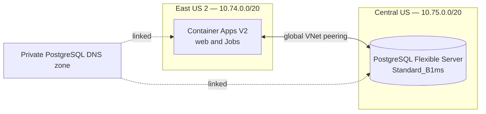

# Azure PostgreSQL for Twilio Comics

Twilio Comics uses Azure Database for PostgreSQL Flexible Server for its app data, admin analytics, and retained conversation history. An Azure Container Apps revision does not own this data, so replacing an image or scaling a replica does not reset the history. The database, its backup policy, and explicit deletion process need to be managed independently.

## Current state and required network change

The initial `cae-twilio-comics` environment was provisioned with Azure's managed network and a placeholder public app. Its network cannot reach the private V2 database. The deployment workflow runs preflight and Drizzle migrations through a manual Container Apps Job inside the new private Container Apps environment. Inspect the V2 resources, database roles, and migration Job before assuming a production database or live migration is ready.

The target uses **two custom VNets with bidirectional global peering**:

| Region and VNet | Address space | Active delegated subnet | Workloads |
| --- | --- | --- | --- |
| East US 2: `vnet-twilio-comics-v2` | `10.74.0.0/20` | `aca-infrastructure`, `10.74.0.0/23`, delegated to `Microsoft.App/environments` | `cae-twilio-comics-v2`, web app, event, recovery, and migration Jobs |
| Central US: `vnet-twilio-comics-pg-cus` | `10.75.0.0/20` | `postgresql`, `10.75.0.0/26`, delegated to `Microsoft.DBforPostgreSQL/flexibleServers` | `twilio-comics-pg-1a1d98` Flexible Server |

The existing `10.74.8.0/26` PostgreSQL subnet in the East US 2 VNet remains declared but is unused. The Bicep template keeps it during an incremental VNet update. The PostgreSQL private DNS zone, `twilio-comics.postgres.database.azure.com`, is linked to **both** VNets, while global peering provides the route. DNS linking and peering are separate requirements. The server uses private VNet access with public network access disabled; its FQDN must resolve to a private address from a V2 Job. The two address spaces must not overlap with other connected VNets.



Create the V2 web placeholder with internal ingress and zero minimum replicas. After database migration and a healthy application revision, the release workflow enables external HTTPS ingress for Twilio webhooks and the public landing page. Keep the existing V1 placeholder until the V2 app and Jobs are verified, then cut over the public URL and Twilio webhooks deliberately. Test the server FQDN and port 5432 from a Job **inside** the East US 2 V2 environment. [Microsoft's PostgreSQL private-access guide](https://learn.microsoft.com/en-us/azure/postgresql/network/concepts-networking-private) explicitly supports clients in a different region through global peering when the private DNS zone is also linked to their VNet; see [Container Apps custom VNet setup](https://learn.microsoft.com/en-us/azure/container-apps/workload-profiles-manage-cli) for the app subnet.

## Database and credentials

1. Register `Microsoft.DBforPostgreSQL` and verify Flexible Server availability in **Central US**. Create the server and a dedicated `twilio_comics` database. The Bicep template requests Burstable `Standard_B1ms`, 32 GB of storage, and 14-day locally redundant backups without a fixed availability zone. Confirm point-in-time restore before accepting real users. Choose private VNet access at creation; this network mode cannot later be moved to another VNet or subnet. East US 2 Burstable requests failed on regional capacity during preparation, so recheck capacity before any SKU or region change and update the cost estimate if a larger SKU is required.
2. Run the private role bootstrap below. It creates `comics_migrator` and `comics_runtime`. The migration role can create and change `public` tables and the `drizzle` schema. The runtime role can read and modify application rows and use sequences, but cannot create database or schema objects. The migration role sets default grants on tables and sequences it creates, so future Drizzle migrations remain usable by the runtime role. The bootstrap fails if imported `public` objects have another owner; review and repair the import before rerunning.
3. Store runtime and migration connection URLs as Key Vault secrets consumed through managed identities. The host Azure CLI seeds both URL secrets from owner-only temporary files, and the private role Job retrieves those URLs and the administrator password from Key Vault. The role provisioner wires `DATABASE_URL=secretref:...` separately on the public app, generation Job, recovery Job, and manual migration Job only after the SQL roles verify. Do not put passwords in Git, GitHub variables, shell arguments, command output, or image layers.
4. Use a URL-encoded password and the server FQDN, with `sslmode=verify-full` in the connection URL. The app's `pg` Pool and read-only migration preflight enforce certificate verification for remote hosts. `drizzle-kit migrate` consumes `DATABASE_URL` directly, so retain that TLS mode for the migration command as well.

Do not commit complete connection URLs, including examples with a fixed password. Tests construct their fake URLs from separate fixture fields. Run `python3 scripts/check-postgres-url-literals.py` before committing. CI runs that guard and an independent secret scan, while GitHub secret scanning and push protection are enabled on this repository. If a scanner reports a credential, first determine whether it is a live value or a test fixture without sharing the value in an issue or chat. Rotate a live credential with the procedure below before closing the alert; only classify a fixture as a test credential after verifying it has no access. [GitGuardian's incident guidance](https://docs.gitguardian.com/public-monitoring/remediate/remediate-incidents) distinguishes those outcomes.

The runtime Pool is bounded to four connections per app or Job process, has a five second connection timeout, and lets short lived Jobs exit when idle. Size the Flexible Server connection limit for the sum of active web replicas and Job executions, then monitor connection pressure and Burstable CPU credits. The cross-region private route adds traffic charges and latency; see the [Azure cost estimate](AZURE_COSTS.md).

### One-time role bootstrap and V2 workload wiring

Run `scripts/provision-private-platform.sh` first, then create the V2 web app and generation/recovery Job placeholders and identities with `scripts/provision-azure.sh` as described in [infrastructure setup](INFRA_SETUP.md). The bootstrap needs those V2 workloads to exist so it can bind their database references. It checks that the ACA environment uses the new private subnet, PostgreSQL has no public access, and Key Vault uses RBAC, purge protection, and a deny-by-default firewall.

Build the role bootstrap and migration images from the committed source. The build helper assembles minimal allowlisted contexts; local `.env` files and unrelated artifacts are not uploaded to ACR. It prints **digest-pinned** image references; copy its two `export` lines into the current shell:

```bash
export SUBSCRIPTION_ID='b001fc6f-ea19-456a-8401-63971a1a1d98'
bash scripts/build-azure-postgres-images.sh
# Copy the printed BOOTSTRAP_IMAGE and MIGRATION_IMAGE export lines here.
PROVISION_POSTGRES_ROLES_CONFIRM=yes bash scripts/provision-postgres-roles.sh
```

The host Azure CLI creates `postgres-comics-runtime-url` and `postgres-comics-migration-url` before it starts the one-off `twilio-comics-db-bootstrap-v2` Job. It generates each role password from 48 random bytes, encodes it as base64url, and writes a single-line, `sslmode=verify-full` connection URL through `az keyvault secret set --file`, with an expiry 365 days from creation to satisfy tenant policy. No URL value appears in a shell argument, environment variable, or command output. Existing URL secrets are downloaded into owner-only temporary files and checked for the expected role, server, database, TLS mode, and password format. A rerun preserves valid existing values **and their expiry dates** and creates only a missing secret; an invalid value stops the run without rotation. The temporary files are removed before the Job starts. The operator's machine never connects to private PostgreSQL or retrieves the bootstrap administrator password.

The Job runs `Dockerfile.bootstrap` in `cae-twilio-comics-v2` and reads all three secrets from Key Vault through its user-assigned identity. That identity temporarily receives Key Vault Secrets User only on `postgres-bootstrap-password` and the two URL secrets; it receives no vault-wide write role. `scripts/provision-postgres-roles.sh` revokes the three secret-scoped grants on exit, including a failed Job. If the host process is forcibly killed, inspect and remove any residual bootstrap identity grants before retrying. The Job provisions and verifies both SQL logins and their privileges using the stored URL passwords. The V2 web identity `id-twilio-comics-v2-web` and worker identity `id-twilio-comics-v2-worker` each receive Key Vault Secrets User only on the **runtime** URL secret. `id-twilio-comics-pg-migrate` receives that role only on the **migration** URL secret. The old V1 placeholder identities receive no database access. The provisioning script binds versionless Key Vault references and `DATABASE_URL` environment variables on the V2 web app, generation Job, recovery Job, and one-container manual migration Job only after SQL verification succeeds. New Key Vault secret versions are picked up by ACA; review a password rotation and its application restarts as an operational change.

If a Key Vault secret reference fails immediately after creating an identity or role assignment, wait for Azure RBAC propagation and rerun the script. Existing URL secrets are reused; a rerun does not rotate their passwords. A failed SQL Job can leave the preseeded URLs in Key Vault without workload bindings; rerun the Job after fixing the cause, then verify migration login and runtime DDL restrictions before opening the release gate.

### Key Vault expiry and database credential rotation

This tenant denies **new Key Vault secret versions without an expiry**. The provisioning scripts set new versions to expire after 365 days; they do not renew or rotate existing versions on a rerun. The existing `postgres-bootstrap-password` in this installation was created with `expires: null`. Set an expiry on its current version without changing its value, then verify the metadata-only result using the command in [infrastructure setup](INFRA_SETUP.md#build-the-private-production-environment). The bootstrap administrator password must also be rotated deliberately with the PostgreSQL server before its expiry; rerunning private-platform provisioning will reuse it.

Monitor the **latest version** of `postgres-bootstrap-password`, `postgres-comics-runtime-url`, and `postgres-comics-migration-url` at least daily. Route Key Vault `Microsoft.KeyVault.SecretNearExpiry` events to an owned alert; Azure emits them [30 days before expiry](https://learn.microsoft.com/en-us/azure/event-grid/event-schema-key-vault). Schedule the rotation at least 60 days ahead so the event is a fallback, and escalate if any secret has fewer than 30 days remaining. A metadata-only inventory is safe to run without displaying credentials:

```bash
az keyvault secret list --vault-name kv-twilio-comics-1a1d98 \
  --query '[].{name:name,expires:attributes.expires}' --output table
```

Rotate the two role URLs **one at a time** during a planned maintenance window:

1. Confirm a recent database backup and restore path. Close SMS/Voice entry, pause browser generation and queue processing, and ensure no migration Job is running. Record the current secret version IDs for rollback without printing their values.
2. Generate a new strong password and a complete `sslmode=verify-full` URL for the selected role in an owner-only local file. Write a **new version** of only that Key Vault URL secret with `az keyvault secret set --file` and a new UTC expiry. Do not put the URL in a shell argument, environment variable, log, or Git.
3. Rerun `scripts/provision-postgres-roles.sh` with the reviewed digest-pinned images. It will read the new URL and set the matching SQL role password in the private bootstrap Job; it does **not** generate a replacement for an existing URL. Keep traffic paused while the Key Vault and SQL passwords may differ.
4. Verify the private Job succeeded and the selected role can authenticate. Restart or roll the affected V2 web/Job workloads so their versionless Key Vault references use the latest version; test database readiness, migration preflight, and a saved comic before reopening traffic. Repeat for the other role, then check the latest expiry dates and remove temporary files. If the Job fails, keep traffic closed and reconcile the SQL password and Key Vault version before retrying.

Rotate `postgres-bootstrap-password` separately by changing the PostgreSQL administrator password and Key Vault secret in one reviewed maintenance procedure, then verify the private role Job can still authenticate. Updating only the Key Vault expiry metadata preserves the current password but is **not** a password rotation. See [Microsoft's single-credential rotation pattern](https://learn.microsoft.com/en-us/azure/key-vault/secrets/tutorial-rotation) for the synchronization risk between a new secret version and the service password.

## Migration execution inside the VNet

The production `Dockerfile` contains the web and worker runtime. `Dockerfile.migrate` builds a separate image containing the checked-in migrations, read-only preflight, and Drizzle CLI. Give a manual Container Apps Job that image, the migration role's `DATABASE_URL`, and no public ingress. Its command runs the read-only preflight first and `pnpm db:migrate` only if preflight succeeds. The deployment workflow keeps serial production concurrency so two schema changes cannot run at once.

GitHub Actions authenticates to Azure through its V2 OIDC deployment principal with a Job-scoped role, starts that Job, waits for a successful terminal execution, and **stops the deployment** if it fails. It does not run preflight or DDL on the GitHub hosted runner against a private database. Triggering a Job through the Azure management API does not require the runner to route to PostgreSQL. A self-hosted runner within the VNet is another possible migration path, but the manual ACA Job keeps the migration network path aligned with the app.

For a fresh empty database, all checked-in Drizzle migrations apply in order. If moving an existing database, run `node --import tsx scripts/check-migration-preflight.ts` from the migration Job first; its journal and schema assessment can block migration until a reviewed baseline or data repair is complete. `pnpm drizzle-kit push` is for a development database, not production schema rollout.

If a previous Neon database contains real stories or history, inventory it before switching URLs. Back it up, restore its data and schema into the new Azure database with a reviewed PostgreSQL migration procedure, and verify row counts, image references, and migration journal state. Do not run the initial migrations against restored app tables or point the public app at an empty replacement database. No source database credentials are available in this workspace, so this cutover has not been performed.

## Acceptance checks

- From the manual Job in East US 2, resolve `<server>.postgres.database.azure.com` to a private Central US address across the VNet peering and connect with verify-full TLS. Confirm a deliberately incorrect server name or certificate fails to connect.
- Run migration preflight, then apply migrations on a fresh empty database. Re-run preflight and confirm zero pending migrations.
- Launch web, event Job, and recovery Job in the new environment and complete one SMS and one Conversation Relay comic. Confirm `/admin` shows their saved records. Roll an image revision and confirm the same records remain.
- Verify PostgreSQL backup and restore settings and rehearse the [user deletion procedure](DATA_DELETION.md). A deletion from the active database does not retroactively edit existing point in time backups; document their expiry and restore handling.

The private network environment, database roles and secrets, and configured migration Job are prerequisites before a production rollout. Keep `PRODUCTION_RELEASE_READY` unset until they and the Twilio sender are ready. Provisioning code alone does not establish a live production migration; verify the Azure Job execution and application readiness before enabling traffic.
